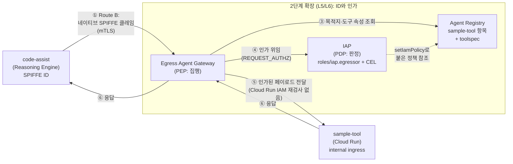
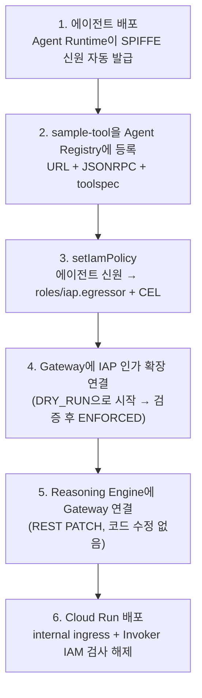
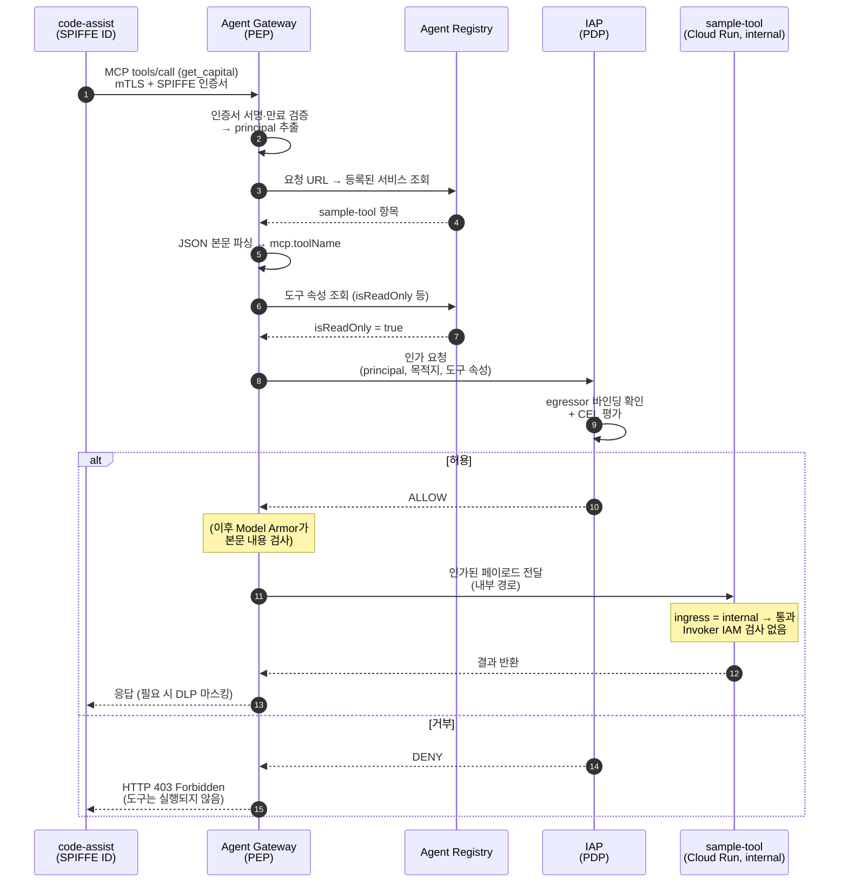
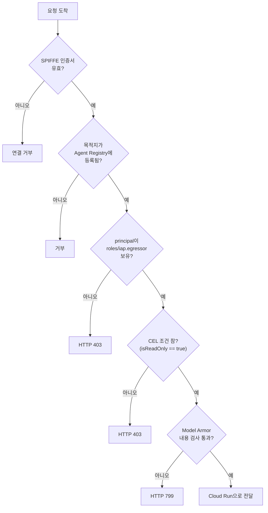
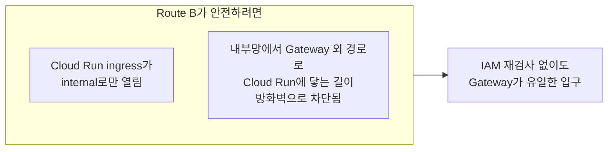

# Agent Gateway에서 Cloud Run까지의 인증 라우팅 (Route B)

> 슬라이드 17 "Agent Gateway에서 Cloud Run까지의 인증 라우팅"의 동작 흐름을 코드와 흐름도로 정리한 문서입니다.
> 핵심: **권한 판단은 Agent Gateway + IAP에서 한 번만 하고, Cloud Run은 internal ingress(네트워크)로만 보호한다.**

---

## 1. 한눈에 보기



| 구성 요소 | 역할 |
|---|---|
| code-assist | 요청하는 에이전트. API 키 없이 플랫폼이 발급한 SPIFFE 신원만 가짐 |
| Agent Gateway | 모든 요청을 가로채고 결과대로 통과·차단 (PEP) |
| Agent Registry | 목적지와 도구 속성(읽기 전용 여부 등)의 출처, IAM 정책이 붙는 대상 |
| IAP | "이 신원이 이 도구를 이 조건으로 써도 되나?" 판정 (PDP) |
| sample-tool | 실제 도구. internal ingress로만 열려 있고 IAM 재검사는 하지 않음 |

---

## 2. 사전 설정 (컨트롤 플레인)



> 아래 코드의 `${...}`는 환경에 맞게 바꿔야 하는 값입니다.
> 각 예시는 슬라이드와 Google Cloud 공식 문서·코드랩의 형식을 따랐으며, **필드 이름과 플래그는 배포 전에 최신 문서로 확인**하세요.

### 2-1. 에이전트 신원 (자동 발급)

에이전트를 Agent Runtime에 배포하면 다음 형식의 신원이 자동으로 부여됩니다.

```text
principal://agents.global.org-${ORGANIZATION_ID}.system.id.goog/
  resources/aiplatform/projects/${PROJECT_NUMBER}/locations/${REGION}/
  reasoningEngines/${INSTANCE_ID}
```

- 조직 → 프로젝트 → 리전 → **인스턴스** 단위까지 식별
- 단기·서명된 인증서이므로 위조나 다른 프로젝트에서의 재사용이 불가능

### 2-2. Agent Registry에 도구 등록

```http
POST https://agentregistry.googleapis.com/v1/projects/${PROJECT_ID}/locations/${REGION}/services?serviceId=sample-tool
Content-Type: application/json
Authorization: Bearer $(gcloud auth print-access-token)

{
  "displayName": "agents-everywhere-sample-tool",
  "interfaces": [
    { "url": "https://sample-tool-xxxx.run.app", "protocolBinding": "JSONRPC" }
  ],
  "mcpServerSpec": {
    "type": "TOOL_SPEC",
    "content": {
      "tools": [
        {
          "name": "get_capital",
          "annotations": { "readOnlyHint": true }
        }
      ]
    }
  }
}
```

- 정책은 **`sample-tool`이라는 이름**에 붙고, 실제 URL은 이 항목 안에만 존재합니다. URL이 바뀌어도 정책은 그대로입니다.
- 도구의 읽기 전용 여부 같은 속성은 요청 본문이 아니라 **여기 등록된 도구 메타데이터**에서 옵니다.
- `annotations` 필드는 MCP 도구 주석(readOnlyHint) 형식을 가정한 예시입니다. 실제 toolspec 스키마는 문서를 확인하세요.

### 2-3. setIamPolicy: 에이전트에 egress 권한 부여 (CEL 조건 포함)

`agents-iap-policy.json`

```json
{
  "policy": {
    "bindings": [
      {
        "role": "roles/iap.egressor",
        "members": [
          "principal://agents.global.org-${ORGANIZATION_ID}.system.id.goog/resources/aiplatform/projects/${PROJECT_NUMBER}/locations/${REGION}/reasoningEngines/${INSTANCE_ID}"
        ],
        "condition": {
          "title": "ReadOnlyToolsOnly",
          "expression": "api.getAttribute('iap.googleapis.com/mcp.tool.isReadOnly', false) == true"
        }
      }
    ]
  }
}
```

```bash
# 레지스트리 전체 대상 예시 (공식 문서 형식)
gcloud iap web set-iam-policy agents-iap-policy.json \
    --project=${PROJECT_ID} \
    --resource-type=agent-registry
```

- **누가:** 특정 Reasoning Engine 인스턴스
- **무엇을:** `roles/iap.egressor` (Gateway를 통해 나갈 권한)
- **조건:** 읽기 전용 도구만
- 개별 서비스(`sample-tool`) 단위로 붙이려면 리소스 유형과 서비스 지정 플래그가 달라집니다. 문서의 "Configure IAM agent policies"를 참고하세요.
- CEL에서는 `request.mcp.toolName` 같은 직접 필드 접근이 지원되지 않으므로 `api.getAttribute()`를 사용합니다.

### 2-4. Gateway에 IAP 인가 확장 연결

`iap-request-authz-extension.yaml`

```yaml
name: my-iap-request-authz-ext
service: iap.googleapis.com
failOpen: true
timeout: 1s
# 처음에는 DRY_RUN(감사 전용)으로 배포해 무엇이 막힐지 로그로 확인한 뒤 ENFORCED로 전환
```

```bash
gcloud beta service-extensions authz-extensions import my-iap-request-authz-ext \
    --source=iap-request-authz-extension.yaml \
    --location=${REGION}

# 이어서 REQUEST_AUTHZ 프로필의 인가 정책을 만들어 이 확장을 Agent Gateway에 연결합니다.
# (인가 정책 YAML의 정확한 형식은 "Delegate authorization with Service Extensions" 문서 참고)
```

> 위 예시는 공식 문서 예제를 그대로 옮긴 것입니다. 운영 환경에서는 확장 장애 시 요청을 통과시키는 `failOpen: true`가 보안 정책에 맞는지 검토하세요.

### 2-5. Reasoning Engine에 Gateway 연결 (코드 수정 없음)

```http
PATCH https://${REGION}-aiplatform.googleapis.com/v1/projects/${PROJECT_ID}/locations/${REGION}/reasoningEngines/${INSTANCE_ID}?updateMask=spec.deploymentSpec.agentGatewayConfig
Content-Type: application/json

{
  "spec": {
    "deploymentSpec": {
      "agentGatewayConfig": {
        "agentToAnywhereConfig": {
          "agentGateway": "projects/${PROJECT_ID}/locations/${REGION}/agentGateways/gateway-egress"
        }
      }
    }
  }
}
```

- `agentToAnywhereConfig` = egress 모드 (에이전트 기준으로 밖으로 나가는 방향)
- 이미지 재빌드나 `agent.py` 수정 없이, 이 시점부터 에이전트의 외부 호출이 모두 Gateway를 거칩니다.

### 2-6. Cloud Run 배포: internal ingress + IAM 재검사 해제

```bash
gcloud run deploy sample-tool \
    --image=${REGION}-docker.pkg.dev/${PROJECT_ID}/${REPO}/sample-tool:latest \
    --region=${REGION} \
    --ingress=internal \
    --no-invoker-iam-check
```

- `--ingress=internal`: 인터넷에서는 접근 불가, 내부 경로로만 도달
- `--no-invoker-iam-check`: Cloud Run의 `run.invoker` 검사를 끔 → 슬라이드의 **"Cloud Run IAM 이중 검사 없음"**
- 조직 정책 `constraints/run.managed.requireInvokerIam`이 걸려 있으면 이 배포는 실패합니다.

---

## 3. 런타임 흐름 (요청마다)



### 3-1. ① 에이전트가 보내는 요청 (MCP / JSON-RPC)

```http
POST https://sample-tool-xxxx.run.app/mcp
Content-Type: application/json

{
  "jsonrpc": "2.0",
  "id": 1,
  "method": "tools/call",
  "params": {
    "name": "get_capital",
    "arguments": { "country": "Korea" }
  }
}
```

- 에이전트 코드는 도구 주소로 보낸다고 생각하지만, Gateway 설정 때문에 요청은 Agent Gateway로 갑니다.
- 별도의 Authorization 헤더나 API 키가 없습니다. 신원은 mTLS 연결의 SPIFFE 인증서로 증명됩니다 (**Route B: 네이티브 SPIFFE 클레임**).

### 3-2. ②~③ Gateway가 판정에 쓰는 정보

| 정보 | 출처 | 예시 값 |
|---|---|---|
| 누가 (principal) | mTLS 인증서의 SPIFFE ID | `.../reasoningEngines/1234567890` |
| 어디로 (목적지) | 요청 URL ↔ Agent Registry 대조 | `services/sample-tool` |
| 무엇을 (도구 이름) | 요청 JSON 본문 파싱 | `get_capital` |
| 도구 성격 | Agent Registry의 toolspec 메타데이터 | `isReadOnly = true` |

### 3-3. ④ IAP의 판정 로직



같은 판정을 의사 코드로 쓰면 다음과 같습니다.

```python
def authorize(request):
    principal = verify_mtls_and_get_spiffe_id(request)          # ②
    if principal is None:
        return reject("invalid identity")

    service = agent_registry.match(request.url)                  # ③ 목적지
    if service is None:
        return reject("unregistered destination")

    tool_name = parse_jsonrpc(request.body)["params"]["name"]    # ③ 도구 이름
    tool_attrs = service.toolspec[tool_name]                     # ③ 도구 속성

    policy = iam.get_policy(service)                             # setIamPolicy로 붙인 정책
    binding = policy.find(role="roles/iap.egressor", member=principal)
    if binding is None:
        return http_403()                                        # ④ 권한 없음

    if binding.condition and not cel_eval(binding.condition, tool_attrs):
        return http_403()                                        # ④ 조건 불충족 (예: 쓰기 도구)

    return allow()                                               # → Model Armor → Cloud Run
```

> 이 의사 코드는 동작 원리를 설명하기 위한 것이며, 실제 Agent Gateway·IAP의 내부 구현이 아닙니다.

### 3-4. ⑤ Cloud Run에서 일어나는 일

| 확인 항목 | 결과 | 이유 |
|---|---|---|
| Ingress | 통과 | Gateway가 내부 경로로 보냄 (`--ingress=internal`) |
| Invoker IAM | **검사 안 함** | `--no-invoker-iam-check` |

권한 판단은 이미 ④에서 끝났으므로 Cloud Run은 같은 일을 반복하지 않습니다.

### 3-5. 거부 응답 예시

```http
HTTP/1.1 403 Forbidden
```
IAP가 거부한 경우입니다 (권한 없음 또는 CEL 조건 불충족). 도구 컨테이너는 실행되지 않습니다.

```json
{
  "content": [{ "type": "text", "text": "Your request was blocked by our content filter." }],
  "isError": true
}
```
Model Armor가 내용을 차단한 경우입니다 (HTTP 799, 이 환경에서 쓰는 차단 코드).

---

## 4. 막히는 경우 정리

| 상황 | 막히는 단계 | 결과 |
|---|---|---|
| 위조·만료된 신원 | ② mTLS 검증 | 연결 거부 |
| 레지스트리에 없는 목적지 | ③ 목적지 대조 | 거부 |
| egressor 권한이 없는 에이전트 | ④ IAP 바인딩 | 403 |
| 쓰기 도구 호출 (isReadOnly = false) | ④ CEL 조건 | 403 |
| 프롬프트 인젝션이 섞인 요청 | Model Armor | 799 |
| Gateway를 건너뛰고 인터넷에서 Cloud Run 직접 호출 | ⑤ internal ingress | 거부 |

---

## 5. 설계상 주의할 점



- **Invoker IAM 검사를 끄면, 내부 네트워크에서 그 서비스에 닿을 수 있는 것은 누구든 호출할 수 있습니다.** Route B는 **네트워크 격리가 IAM 이중 검사를 대신하는 구조**입니다.
- 따라서 섹션 01의 네트워크 격리(전용 VPC, 공인 IP 없음, 방화벽)가 함께 갖춰져야 합니다.
- 더 강한 보호가 필요하면 Cloud Run에서도 `run.invoker`를 검사하는 이중 잠금 구성(슬라이드 16의 설명)을 선택할 수 있습니다.

### Route B와 이중 잠금 비교

| | Route B (슬라이드 17) | 이중 잠금 (슬라이드 16) |
|---|---|---|
| 판단 위치 | Gateway + IAP 한 곳 | Gateway + IAP, Cloud Run IAM 두 곳 |
| Cloud Run 보호 | internal ingress (네트워크) | internal ingress + `run.invoker` |
| 장점 | 구성 단순, 판단 기준이 한 곳 | Gateway 우회 시에도 신원 검사 |
| 전제 조건 | 네트워크 격리가 확실해야 함 | 신원을 Cloud Run IAM이 이해하는 형태로 전달해야 함 |

> 슬라이드 16("Cloud Run에 run.invoker 바인딩")과 슬라이드 17("Cloud Run IAM 이중 검사 없음")은 서로 다른 경로를 설명하는 것으로 보입니다. "Route B"라는 이름으로 보아 덱 작성자는 두 경로를 염두에 둔 것으로 추정되며, 실습이 어느 경로를 쓰는지 확인 후 발표에서 명시하는 것을 권장합니다.

---

## 6. 참고 문서

- [Configure IAM agent policies](https://docs.cloud.google.com/gemini-enterprise-agent-platform/govern/policies/configure-iam-policies)
- [IAM policies overview (Agent Gateway)](https://docs.cloud.google.com/gemini-enterprise-agent-platform/govern/policies/iam-overview)
- [Delegate authorization with Service Extensions](https://docs.cloud.google.com/gemini-enterprise-agent-platform/govern/gateways/delegate-authorization)
- [Codelab: Agent Gateway egress from Agent Runtime to external MCP](https://codelabs.developers.google.com/agw-cuj-arun-egress-emcp)
- [Codelab: Agent Gateway egress from Agent Runtime to VPC network](https://codelabs.developers.google.com/agw-cuj-arun-egress-vpc)
- [Cloud Run: Allowing public (unauthenticated) access](https://docs.cloud.google.com/run/docs/authenticating/public)
